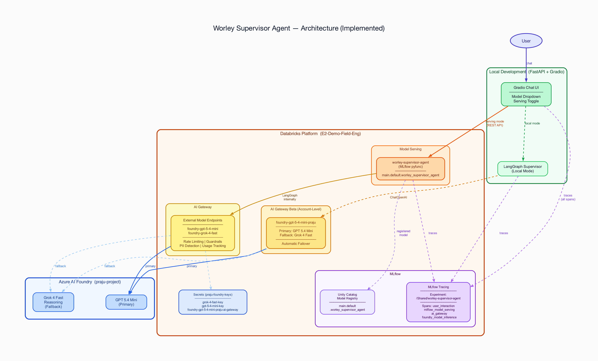

# Worley Multi-Agent Supervisor

A multi-agent supervisor built with LangGraph, deployed as a Databricks App with MLflow model serving and AI Gateway routing. A supervisor node classifies user questions and routes them to specialised sub-agents.

## Architecture



**Flow:** User message → FastAPI app → `worley-supervisor-agent` serving endpoint → LangGraph supervisor → sub-agent → response streamed back via SSE.

### Sub-Agents

| Agent | Endpoint | Purpose |
|---|---|---|
| **General Assistant** | `azure-foundry-otel` | GPT 5.4 via Azure AI Foundry with OTEL tracing |
| **Knowledge Assistant** | `worley-knowledge-assistant` | Worley-specific documents, policies, and engineering standards |
| **Genie Space** | Genie MCP | ASX stock data, trading volume, and financial metrics |

### LLM Endpoints (AI Gateway)

| Endpoint | Provider | Used By |
|---|---|---|
| `foundry-gpt-5-4-mini` | Azure AI Foundry (GPT 5.4 Mini) | Supervisor routing |
| `azure-foundry-otel` | Azure AI Foundry (GPT 5.4) with OTEL | General assistant |
| `worley-knowledge-assistant` | Databricks agent | Knowledge queries |

## Quick Start

### Prerequisites

- Python 3.10+
- Databricks CLI with `worley-dev` profile configured
- Access to the AI Gateway endpoints on the workspace

### Local Development

```bash
cd worley-multi-agent-supervisor
pip install -r requirements.txt

# Build frontend
cd frontend && npm install && npm run build && cd ..

# Run
export DATABRICKS_CONFIG_PROFILE="worley-dev"
uvicorn app:app --host 0.0.0.0 --port 8000
```

Open [http://localhost:8000](http://localhost:8000). The frontend dev server with hot reload:

```bash
cd frontend && npm run dev
```

This proxies `/api/*` to `http://localhost:8000`.

## Deployment

Deployment uses Databricks Asset Bundles (DABs). The bundle is configured for the `development` target at `adb-7405604717684409.9.azuredatabricks.net`.

### 1. Deploy the bundle

```bash
databricks bundle deploy -t development
```

### 2. Run the setup pipeline

```bash
databricks bundle run deploy_agent -t development
```

This runs two tasks in sequence:
1. **`deploy_foundry_otel`** — Logs the Azure AI Foundry OTEL ChatModel to Unity Catalog and creates/updates the `azure-foundry-otel` serving endpoint
2. **`deploy_mlflow_model`** — Logs the LangGraph supervisor agent to Unity Catalog and deploys the `worley-supervisor-agent` serving endpoint via `databricks-agents`

### 3. Deploy the app

```bash
databricks apps deploy worley-supervisor-app --profile worley-dev \
  --source-code-path /Workspace/Users/_matthew.moloney@worley.com/.bundle/worley-supervisor-poc/development/files
```

The app builds the React frontend at startup (`npm install && npm run build`) then runs `uvicorn`.

## API Endpoints

| Endpoint | Method | Description |
|---|---|---|
| `/api/chat` | POST | Send a message (non-streaming, returns full response) |
| `/api/chat/stream` | POST | Send a message (SSE streaming, word-by-word delivery) |
| `/api/traces` | GET | Fetch MLflow traces for the monitoring dashboard |
| `/api/health` | GET | Health check |

### SSE Streaming Protocol

`POST /api/chat/stream` returns `text/event-stream` with typed events:

```
data: {"type":"delta","content":"Hello"}
data: {"type":"delta","content":" world"}
data: {"type":"metadata","routed_agent":"general_assistant","latency_ms":1234.5,...}
data: [DONE]
```

## Observability

### MLflow Tracing

All agent nodes are decorated with `@mlflow.trace`, providing automatic span capture for routing decisions, LLM calls, and token usage. Traces are logged to the `/Shared/worley-supervisor-agent` experiment.

### Azure AI Foundry OTEL Tracing

The `azure-foundry-otel` endpoint emits OpenTelemetry traces to the Databricks OTLP endpoint, recording:
- `gen_ai.request.model` — model name
- `gen_ai.usage.input_tokens` / `output_tokens` — token counts
- `foundry.latency_seconds` — call latency
- `gen_ai.input.messages` / `gen_ai.output.messages` — full I/O

Traces are stored in the UC table `az_databricks_poc.azure_foundry_otel.otel_spans`.

### AI Gateway

The `foundry-gpt-5-4-mini` endpoint has AI Gateway features enabled:
- Inference table logging to `az_databricks_poc.multi_agent_supervisor`
- Usage tracking

## Project Structure

```
.
├── app.py                          # FastAPI backend (chat, streaming, traces, health)
├── app.yaml                        # Databricks App startup command
├── databricks.yml                  # DABs bundle config (app + deploy job)
├── requirements.txt                # Python dependencies
├── agent/
│   ├── config.py                   # Endpoints, auth, MLflow init
│   ├── nodes.py                    # LangGraph nodes (supervisor, general, KA, genie)
│   ├── state.py                    # LangGraph state schema
│   ├── supervisor.py               # Graph construction and compilation
│   └── mlflow_model.py             # MLflow ChatModel wrapper for serving
├── azure-foundry-model/
│   ├── model.py                    # Azure AI Foundry ChatModel with OTEL tracing
│   └── deploy.py                   # Standalone deploy script (alternative to DABs)
├── frontend/
│   ├── src/
│   │   ├── api/client.ts           # API client (sendMessage, sendMessageStream)
│   │   ├── pages/Chat.tsx          # Chat interface with SSE streaming
│   │   ├── pages/Monitoring.tsx    # Trace analytics dashboard
│   │   └── components/             # ChatMessage, Layout
│   ├── vite.config.ts              # Vite dev server with API proxy
│   └── package.json
├── setup/
│   ├── 00_create_catalog.py        # Create UC catalog/schema (optional)
│   ├── 01_register_foundry_endpoints.py  # Register AI Gateway external models
│   ├── 02_deploy_agent_mlflow.py   # Deploy supervisor agent to serving
│   └── 03_deploy_foundry_otel.py   # Deploy Foundry OTEL ChatModel to serving
└── docs/
    ├── design-brief.md
    ├── monitoring-page-design.md
    └── architecture.mmd            # Mermaid diagram source
```

## Configuration

Key environment variables (set via `app.yaml` or serving endpoint config):

| Variable | Default | Description |
|---|---|---|
| `SUPERVISOR_ENDPOINT` | `worley-supervisor-agent` | Serving endpoint the app proxies to |
| `SUPERVISOR_MODEL` | `foundry-gpt-5-4-mini` | LLM for supervisor routing |
| `GENERAL_ASSISTANT_ENDPOINT` | `azure-foundry-otel` | LLM for general assistant |
| `SUPERVISOR_KA_ENDPOINT` | `worley-knowledge-assistant` | Knowledge assistant endpoint |
| `SUPERVISOR_GENIE_SPACE_ID` | (configured) | Genie Space for ASX data |
| `MLFLOW_EXPERIMENT_ID` | (configured) | MLflow experiment for trace logging |
